<div align="center">

### 📥 一键下载（点击即存）

**[📥 一键开箱案例库 OB-Case-TaskNexusPro.zip（23 MB）](https://github.com/programerni/obsidian-TaskNexus-free/raw/main/downloads/OB-Case-TaskNexusPro.zip)** ｜ **[📥 Pro 插件 TaskNexusPro-1.0.45.zip（1.4 MB）](https://github.com/programerni/obsidian-TaskNexus-free/raw/main/downloads/TaskNexusPro-1.0.45.zip)**

**🔑 激活页面**：这是激活页面——**输入个人邮箱，一键提交激活申请**，管理员会**自动发送激活码到个人邮箱**。


</div>

---

<div align="center">

# Task Nexus Pro

**[中文](#-中文)** | **[English](#-task-nexus-pro-english)**

> 🚀 在 Obsidian 中实现企业级项目排产与团队协作

</div>

---

## 🇨🇳 中文

Task Nexus 现在只有一个 **Pro 版**：全部功能随安装包提供，免费安装后按**免费额度**长期使用；购买激活码填入插件设置后，数量、月度与终身额度全部解除。

- **免费额度**：项目 ≤ 3 ／ 目标（OKR） ≤ 3 ／ KR ≤ 9 ／ 人员 ≤ 3 ／ 自定义 Agent ≤ 2
- **月度额度**（每月 1 日重置）：AI 任务拆解 5 ／ AI 作业续杯 5 ／ AI 会议纪要 3 ／ AI 复盘报表 4 ／ 滴答·飞书·Notion 同步各 50
- **试用与终身额度**：规划视图 30 次 ／ 链式依赖 30 次 ／ AI 作业累计 50 次
- **激活后**：以上额度全部解除，功能不再受限；后续版本更新免费

> 额度为程序内置默认值，以插件内「激活 / 额度中心」与官网配置为准。额度用尽仅对应功能暂停，历史数据不受影响。

下方为 Pro 版全部核心功能的说明。

### ✨ Pro 版核心功能

#### 🗂️ 项目视图
从单任务维度升级到项目维度，掌握全局进度

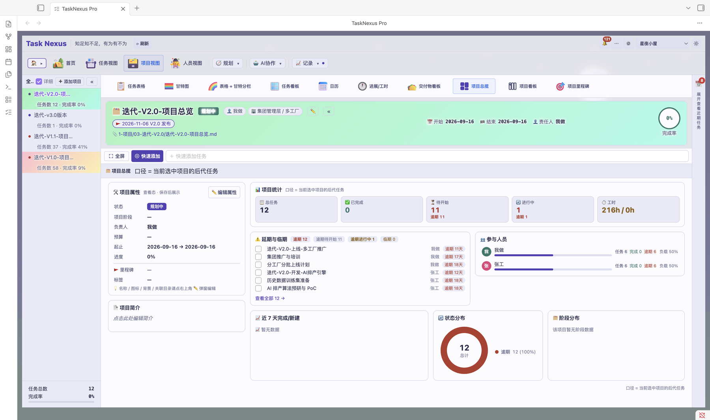

- **多项目概览** — 一个界面管理所有项目，查看各项目进度与状态
- **项目统计** — 每个项目的完成率、任务数、延迟率一目了然
- **人员负载** — 查看团队成员的任务分配情况，避免过载
#### 👥 人员视图
按人看任务：谁在做什么、负载是否均衡


- **人员总览** — 按成员汇总任务分布与进度
- **多视图切换** — 与任务视图同款的表格 / 甘特 / 看板 / 日历视图
- **人员维度统计** — 交付物看板、进展与工时按人员维度查看


#### 📅 今日面板
聚焦当天最重要的事，一眼看清今天该做什么


- **今日待办** — 自动筛选今日到期、今日开始的任务
- **看板模式** — 今日任务按状态分列展示
- **优先级排序** — 高优先级任务置顶，不遗漏关键事项

#### 📊 统计面板
用数据驱动决策的全局看板

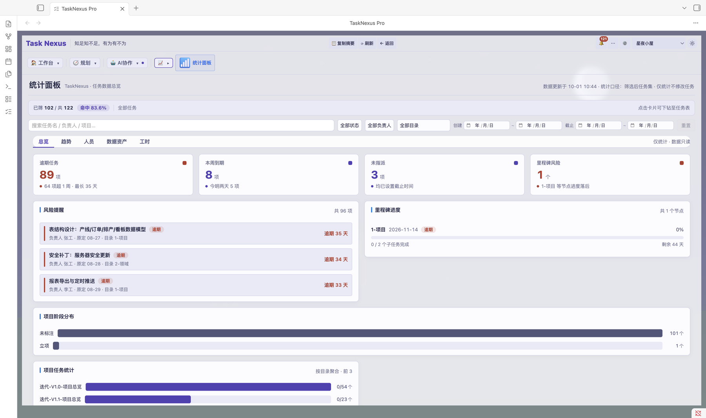

- **完成率趋势** — 可视化每周/每月完成率变化
- **延迟分析** — 识别哪些任务经常延期，找到瓶颈
- **工作量分布** — 按负责人/项目/优先级多维度分析

#### ⏱️ 任务计时
精确掌握每个任务花了多少时间

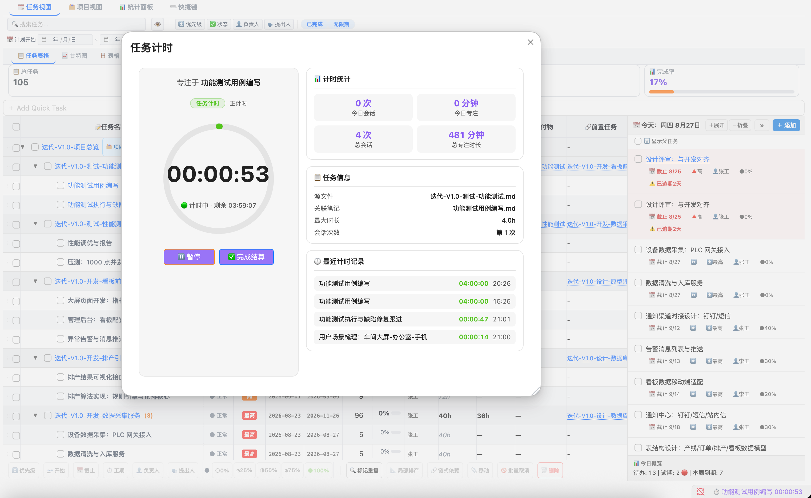

- **番茄钟式追踪** — 为每个任务启动专注计时
- **效率分析** — 了解时间在不同任务类型上的分配
- **工时结算** — 按项目汇总工时，支持报价参考

#### 📝 变更记录
让每次调整都有迹可循


- **自动记录** — 任务的每次修改自动生成变更记录
- **审计追踪** — 查看谁在什么时候改了什么
- **一键回退** — 发现误操作可快速恢复到之前状态

#### 🔔 通知提醒
重要事项绝不被遗忘


- **逾期提醒** — 任务到期自动弹出通知
- **指派通知** — 有人给你分配任务时即时提醒
- **今日提醒** — 每天打开 Obsidian 即看到今日重点

#### 📋 任务看板
拖拽式看板，任务状态一目了然

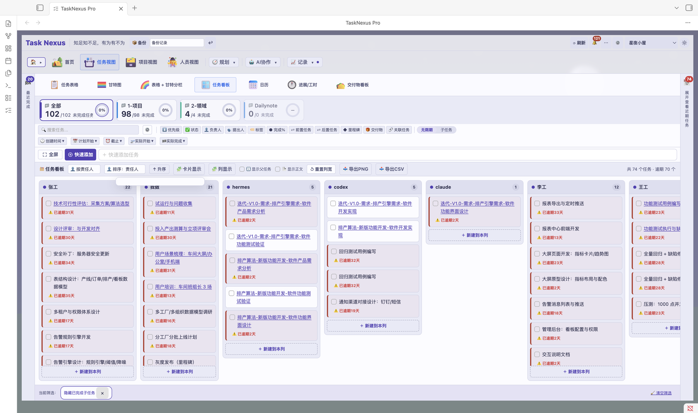

- **状态分列** — 待办、进行中、已完成分列展示
- **拖拽流转** — 直接拖拽任务卡片切换状态
- **快速操作** — 看板中直接编辑、删除、标记完成

#### 👥 调度排产
从个人任务管理升级为团队协作排产

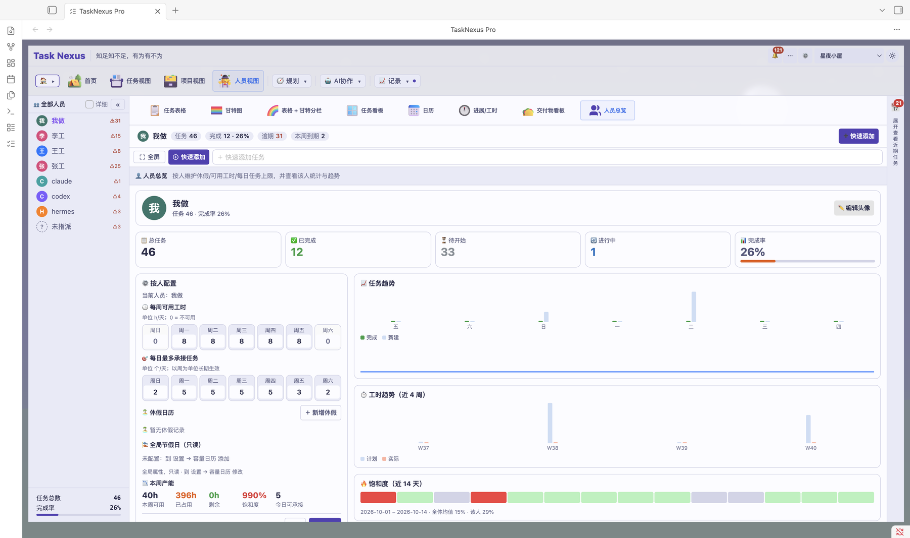

- **人员排产** — 按 `role/指派/name` 标签解析团队成员
- **产能管理** — 为每个成员设置不同的工作容量
- **负载均衡** — 自动检测过载成员，建议任务分配

#### 🤖 AI 智能拆解
让 AI 帮你分解复杂任务

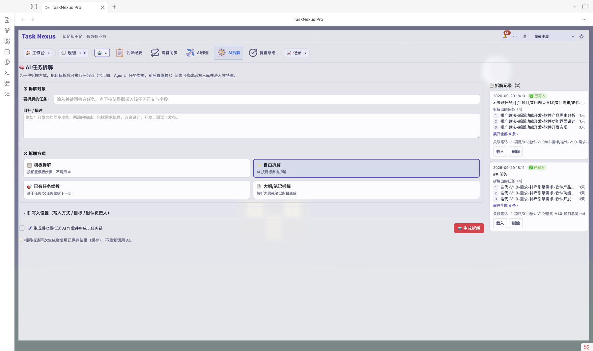

- **需求拆解** — 输入复杂需求，AI 自动拆分为可执行子任务
- **会议导入** — 从会议纪要中提取待办事项
- **智能排期** — AI 根据依赖关系和优先级建议排期

#### 🔄 TickTick/Dida365 同步
打通外部任务管理工具

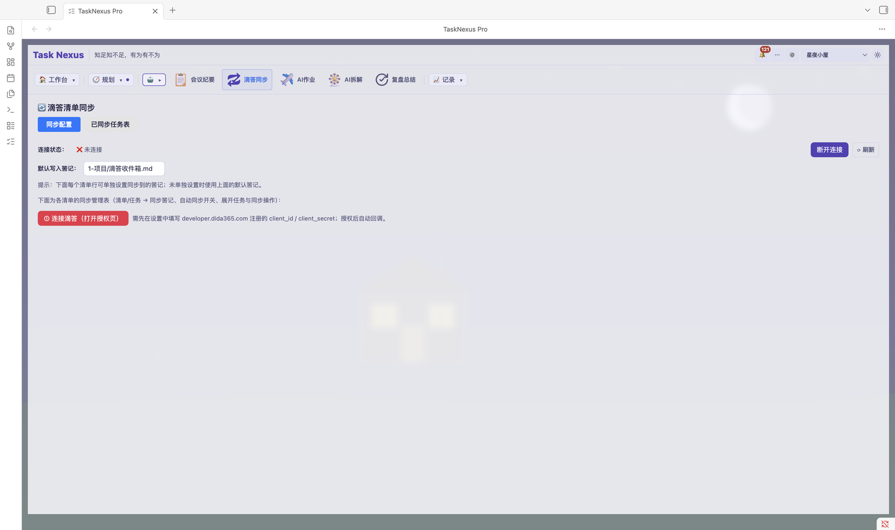

- **双向同步** — Obsidian 与滴答清单数据实时同步
- **多端协作** — 手机端记录的任务自动同步到 Obsidian
- **批量操作** — 批量导入/导出任务

#### 🧠 规划视图
多维度任务规划与脑图展示

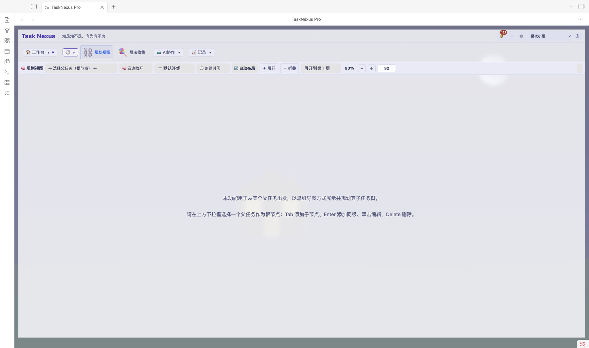

- **脑图模式** — 任务层级以思维导图形式展示
- **树形规划** — 从上到下梳理任务依赖与结构
- **多布局** — 支持多种展示布局，灵活切换
#### 📦 交付物管理
任务成果统一管理，支持拖拽上传


- **集中管理** — 任务详情交付物 Tab 集中管理所有成果文件
- **拖拽上传** — 支持从其他应用直接拖拽上传
- **自动关联** — 交付物与所属任务自动关联，随任务流转

#### 🤖 AI 作业
专为 AI Agent 设计的任务看板，人机协作的自动化开发流水线


- **自动流转** — AI 自动领取、执行、交付任务
- **状态看板** — 看板流转 待作业 → 作业中 → 待审核 → 已部署 → 已关闭
- **全程可视** — 交付与部署进度全程可视化

#### 📝 AI 会议纪要
会议记录交给 AI，自动整理成结构化纪要


- **协作菜单直达** — AI 协作菜单内直接使用，与任务体系同库管理
- **结构化提炼** — 自动提炼要点、结论与待办事项
- **沉淀为笔记** — 纪要沉淀为库内笔记，可继续关联任务

#### 🔁 AI 复盘总结
让 AI 帮你写复盘，计划与总结形成闭环


- **一键生成** — AI 协作菜单内一键生成复盘总结
- **计划联动** — 与首页每日计划、每日复盘联动
- **可回溯** — 复盘结果沉淀到库内笔记，随时回溯

#### 🎯 目标（OKR）
目标与关键结果集中管理，团队往哪儿打一目了然

- **O / KR 统一管理** — 一级「🎯 目标」Tab，目标（O）与关键结果（KR）集中管理
- **数值型进度** — KR 支持当前值 / 目标值，按年 / 季 / 月周期推进
- **负责人与复盘** — 每个目标都有负责人，按周期复盘进度与风险
- **首页卡片** — 首页仪表盘可添加目标总览、风险 KR、周期复盘卡片

#### 🏠 首页仪表盘
打开插件即是首页，待办、进展、统计一屏掌握


- **自由布局** — 卡片自由拖拽换位，支持一行多卡片与跨行布局
- **卡片自定义** — 每个卡片可设置显示/隐藏、显示条数、自定义图标与图标大小
- **背景图** — 顶部日期欢迎区支持自定义背景图
- **想法转任务** — 想法速记记下的灵感可一键转成任务

#### 🖼️ 项目图标与背景图
每个项目一张专属门面，列表里一眼认出


- **项目图标** — 编辑项目时为项目挑选独立图标
- **专属背景图** — 为项目设置专属背景图
- **全局展示** — 项目面板、项目视图标题、任务行、统计面板头部同步展示


### 🖼️ 更多界面截图

| **🏠 工作台首页** | **🧭 任务视图 · 甘特图** |
| :-: | :-: |
| 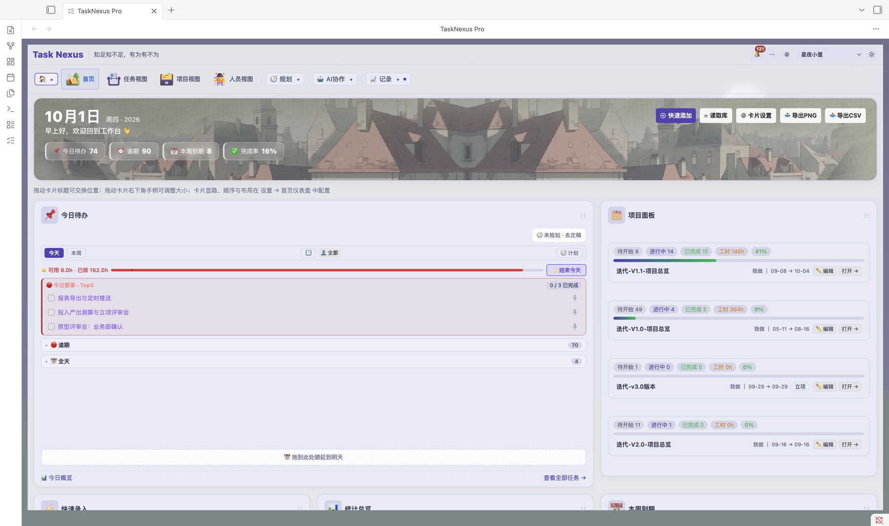 | 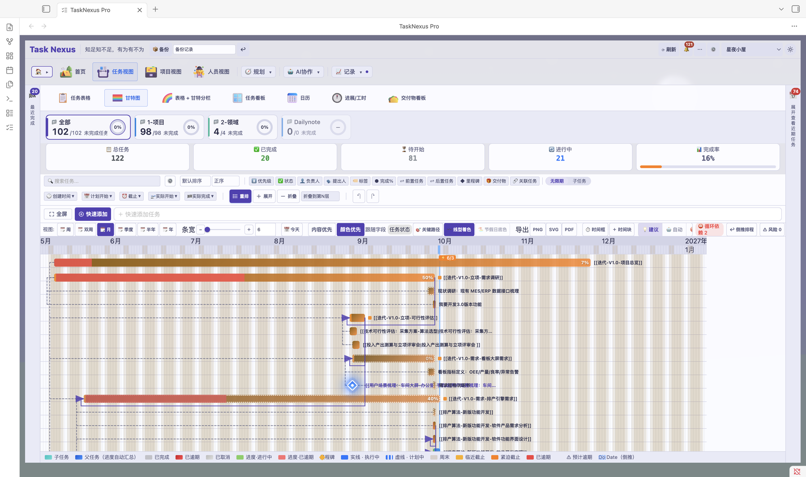 |
| **📋 项目视图 · 看板** | **👥 人员视图 · 甘特图** |
| 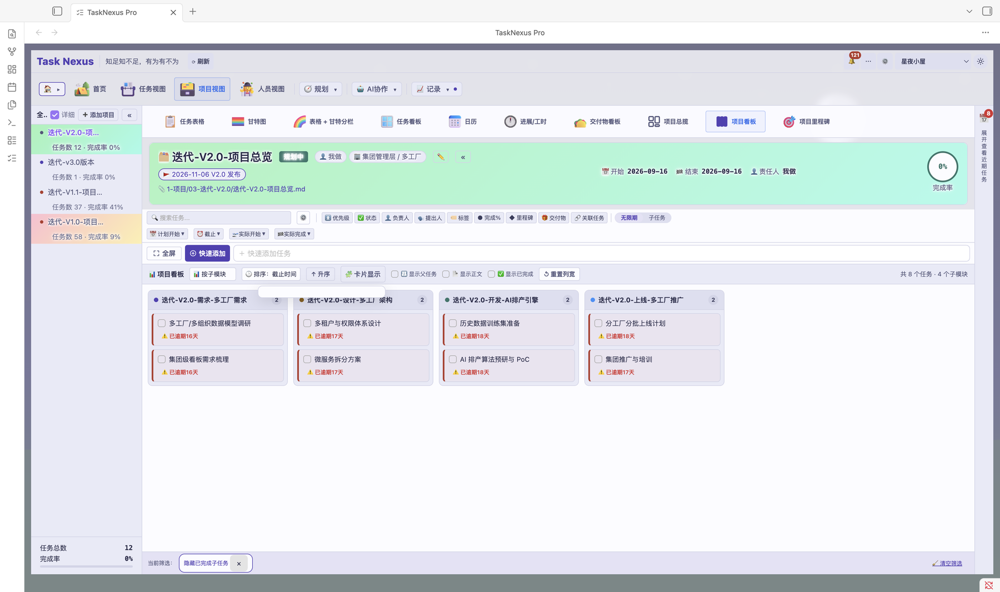 | 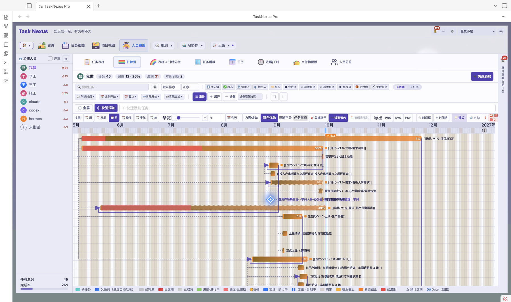 |
| **💡 想法收集** | **📝 会议纪要** |
| 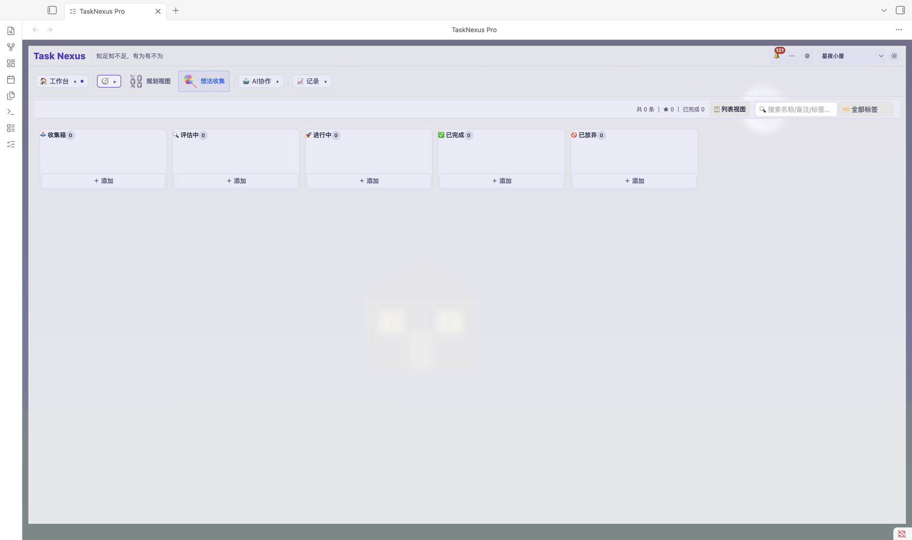 | 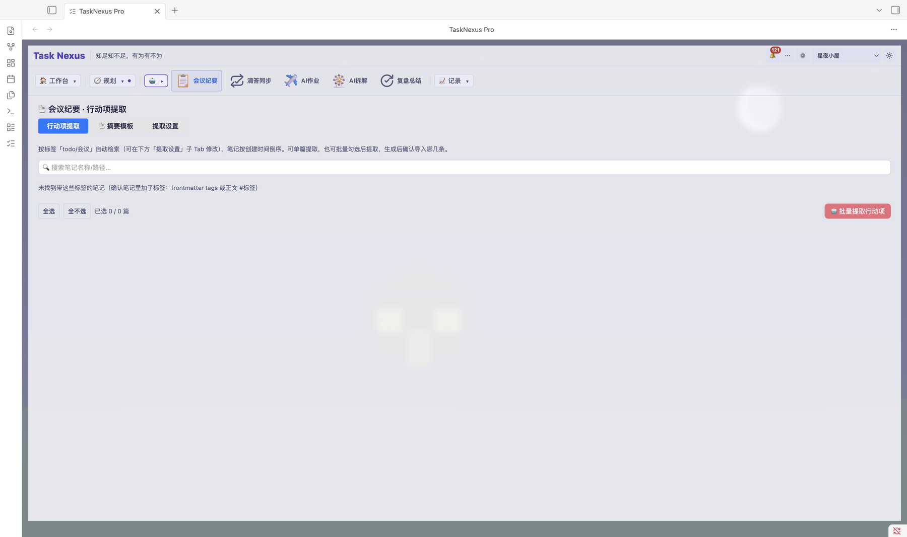 |
| **🔁 复盘总结** | **⏱️ 进展与工时** |
| 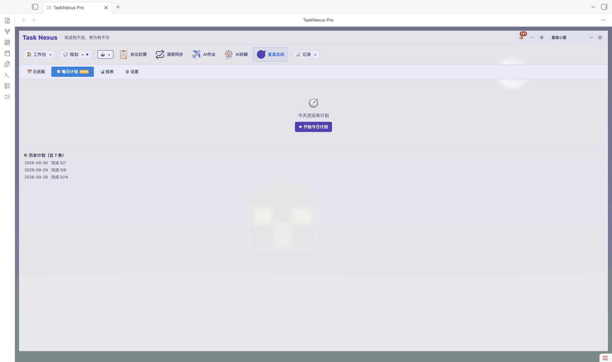 | 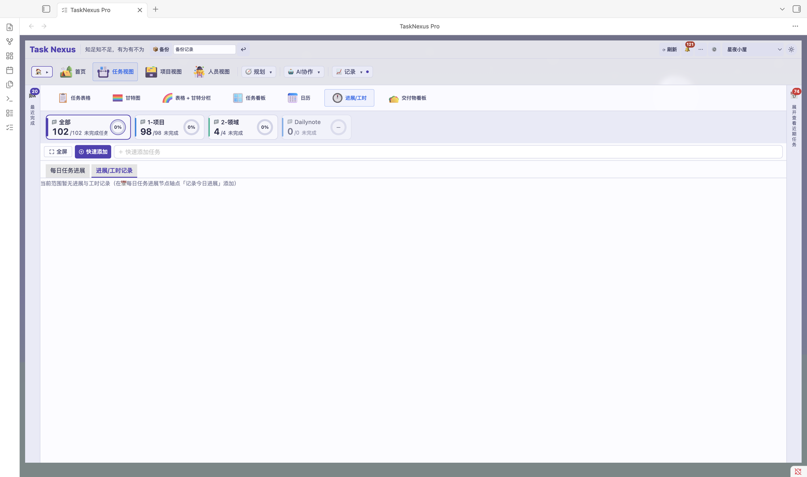 |

---

### 🆚 免费额度 vs 激活解锁

| 能力 / 额度 | 免费额度（未激活） | 激活后 |
|------|:------:|:------:|
| 安装与更新 | 免费 | 免费（后续版本更新不收费） |
| 甘特图 / 看板 / 日历等全部视图 | ✅ | ✅ |
| 项目数 | ≤ 3 | 无限制 |
| 目标（OKR）数 | ≤ 3 | 无限制 |
| KR 数 | ≤ 9 | 无限制 |
| 人员数 | ≤ 3 | 无限制 |
| 自定义 Agent 数 | ≤ 2 | 无限制 |
| AI 任务拆解 | 5 次 / 月 | 无限制 |
| AI 作业续杯 | 5 次 / 月 | 无限制 |
| AI 作业累计 | 50 次 | 无限制 |
| AI 会议纪要 / 微信整理 | 3 次 / 月 | 无限制 |
| AI 复盘报表 | 4 次 / 月 | 无限制 |
| 滴答清单 / 飞书 / Notion 同步 | 各 50 条 / 月 | 无限制 |
| 规划视图 / 链式依赖 | 各 30 次试用 | 无限制 |
| 价格 | 免费安装、免费使用 | 按年 9.9 或一次 68 元（以小红书实际价格为准） |

---

### 💰 定价与激活

**免费安装，额度内免费使用**；激活码按年订阅 9.9 或一次性 68 元（以小红书主页置顶笔记的实际价格为准），激活后额度全部解除、后续更新免费。

👉 **购买与激活说明**: [https://tasknexus.itwize.top/pricing.html](https://tasknexus.itwize.top/pricing.html)

激活步骤：Obsidian → 设置 → TaskNexus → 「激活」→ 填入「🔑 激活码」→ 点「🔓 立即激活」。

#### 💳 扫码付款（微信 / 支付宝）

不想走小红书也可以直接扫码付款：付款后把**付款截图**和你的邮箱 / 微信号发给我们，核对后当天发放激活码。

| 微信收款码 | 支付宝收款码 |
| :---: | :---: |
|  |  |
| 微信「扫一扫」· 按年 9.9 / 一次性 68 元 | 支付宝「扫一扫」· 按年 9.9 / 一次性 68 元 |

- 微信发 **ITzhihui_hj**（备注「TaskNexus 激活」）或邮件 **programerni@qq.com** 领取激活码
- 扫码与小红书下单**价格一致**，任选其一，不必重复付款

---

### 📦 安装方式

#### 方式一：手动安装（推荐）

1. 下载最新 Release（Pro 版安装包）→ [Releases](../../releases)
2. 解压 zip 文件
3. 将三个文件复制到 Obsidian 库的插件目录：
   ```
   YourVault/.obsidian/plugins/tasknexus-free/
   ├── main.js
   ├── manifest.json
   └── styles.css
   ```
4. 打开 Obsidian → 设置 → 社区插件
5. 启用 **Task Nexus**（Pro 版，未激活时按免费额度使用）

#### 方式二：BRAT 插件

1. 安装 [BRAT](https://github.com/TfTHacker/obsidian42-brat) 插件
2. 打开 BRAT 设置 → 添加 Beta 插件
3. 输入：`programerni/obsidian-tasknexus-free`
4. 启用插件

---

### 📋 系统要求

- Obsidian v1.5.7 或更高版本
- 桌面版 / 移动版均支持

---

### 🤝 联系与支持

- **官网**: [https://tasknexus.itwize.top/](https://tasknexus.itwize.top/)
- **微信**: ITzhihui_hj（激活问题与技术支持）
- **小红书**: [https://www.xiaohongshu.com/user/profile/55878c26c2bdeb61d6dcbb31](https://www.xiaohongshu.com/user/profile/55878c26c2bdeb61d6dcbb31)
- **GitHub Issues**: [提交问题或功能建议](../../issues)

---

## 🇺🇸 Task Nexus Pro (English)

Task Nexus now ships as a single **Pro edition**: every module is included in the installer, and it runs within the **free quota** for as long as you like. A licence key pasted into the plugin settings removes every quantity, monthly and lifetime quota.

- **Free quota**: projects ≤ 3 · goals (OKR) ≤ 3 · key results ≤ 9 · people ≤ 3 · custom agents ≤ 2
- **Monthly quotas** (reset on the 1st): AI task decomposition 5 · AI job refills 5 · AI meeting notes 3 · AI review report 4 · TickTick / Feishu / Notion sync 50 items each
- **Trial and lifetime**: planning view 30 uses · chained dependencies 30 uses · AI jobs 50 runs lifetime
- **After activation**: every quota removed, no feature limits, future updates included

> The numbers above are the built-in defaults; the plugin's activation / quota centre and the website config are the source of truth. When a quota runs out only that feature pauses — your existing data is untouched.

### ✨ Pro Features

#### 🗂️ Project View
Upgrade from individual tasks to project-level management


- **Multi-project Overview** — Manage all projects in one interface
- **Project Statistics** — Completion rate, task count, delay rate at a glance
- **Team Workload** — View task distribution across team members
#### 👥 People View
See tasks by person: who is doing what and whether the workload is balanced


- **People Overview** — Task distribution and progress summarized per member
- **Multiple Views** — Table / Gantt / Kanban / Calendar, same as the task view
- **Per-person Stats** — Deliverables board, progress and work hours by person


#### 📅 Today Panel
Focus on what matters most today


- **Today's Tasks** — Auto-filter tasks due/starting today
- **Kanban Mode** — Today's tasks displayed by status columns
- **Priority Sort** — High-priority tasks pinned to top

#### 📊 Statistics Dashboard
Data-driven decision-making dashboard


- **Completion Trends** — Visualize weekly/monthly completion rate changes
- **Delay Analysis** — Identify frequently delayed tasks and bottlenecks
- **Workload Distribution** — Multi-dimensional analysis by assignee/project/priority

#### ⏱️ Task Timer
Precisely track time spent on each task


- **Pomodoro-style Tracking** — Start focused timer for each task
- **Efficiency Analysis** — Understand time allocation across task types
- **Time Settlement** — Aggregate hours by project for billing reference

#### 📝 Changelog
Every adjustment is traceable


- **Auto-Recording** — Every task modification generates a changelog entry
- **Audit Trail** — See who changed what and when
- **One-click Rollback** — Quickly restore to previous state

#### 🔔 Notifications
Never miss important events


- **Overdue Alerts** — Auto-popup when tasks are overdue
- **Assignment Notifications** — Instant alert when someone assigns you a task
- **Daily Reminder** — See today's priorities when opening Obsidian

#### 📋 Task Kanban
Drag-and-drop kanban for visual task management


- **Status Columns** — To-do, In Progress, Done displayed in columns
- **Drag-and-Drop** — Move task cards between status columns
- **Quick Actions** — Edit, delete, or complete tasks directly from kanban

#### 👥 Team Scheduling
From personal task management to team collaboration


- **Assignee Parsing** — Parse `role/assign/name` tags for team view
- **Individual Capacity** — Set different work capacity per member
- **Load Balancing** — Auto-detect overloaded members, suggest redistribution

#### 🤖 AI Task Decomposition
Let AI break down complex tasks


- **Requirement Decomposition** — Input complex requirements, AI splits into subtasks
- **Meeting Import** — Extract action items from meeting notes
- **Smart Scheduling** — AI suggests schedule based on dependencies and priority

#### 🔄 TickTick/Dida365 Sync
Bridge external task management tools


- **Bidirectional Sync** — Real-time sync between Obsidian and TickTick/Dida365
- **Multi-device** — Tasks recorded on mobile auto-sync to Obsidian
- **Batch Operations** — Bulk import/export tasks

#### 🧠 Planning View
Multi-dimensional task planning with mind-map display


- **Mind-map Mode** — Task hierarchy displayed as mind map
- **Tree Planning** — Top-down dependency and structure analysis
- **Multiple Layouts** — Flexible layout switching
#### 📦 Deliverable Management
Keep every task outcome in one place with drag-and-drop upload


- **Centralized Tab** — All outcome files managed in the task detail Deliverables tab
- **Drag & Drop Upload** — Drag files straight from other apps
- **Auto-Linked** — Deliverables automatically linked to their task

#### 🤖 AI Task Board
A task board built for AI agents — a human-in-the-loop automation pipeline


- **Auto Claim & Deliver** — AI agents claim, execute and deliver tasks automatically
- **Status Pipeline** — Board flow: Pending → Working → Review → Deployed → Closed
- **Full Visibility** — Delivery and deployment progress visualized end to end

#### 📝 AI Meeting Minutes
Hand meeting notes to AI and get structured minutes automatically


- **From AI Menu** — Used directly inside the AI collaboration menu, stored in the same vault
- **Structured Summary** — Key points, conclusions and action items extracted automatically
- **Saved as Notes** — Minutes become vault notes that can be linked to tasks

#### 🔁 AI Retrospective Summary
Let AI write your retrospective — plan, execute, review in one loop


- **One-click Generation** — Generate a retrospective summary from the AI collaboration menu
- **Linked to Daily Plan** — Works together with the home dashboard's daily plan and review
- **Archived in Vault** — Retrospectives are saved as notes for later reference

#### 🎯 Goals (OKR)
Manage objectives and key results in one place — everyone knows where the team is heading

- **O / KR Management** — A dedicated Goals tab for objectives and key results
- **Numeric Progress** — KRs track current / target values on a yearly / quarterly / monthly cycle
- **Owners & Review** — Every goal has an owner, with periodic progress and risk review
- **Dashboard Cards** — Add goal overview, at-risk KR and review cards to the home dashboard

#### 🏠 Home Dashboard
The plugin opens as a dashboard — todos, progress and stats on one screen


- **Free Layout** — Drag cards anywhere, multiple cards per row and cross-row layouts
- **Card Settings** — Per-card show/hide, max items, custom icon and icon size
- **Custom Banner** — Custom background image for the top date / welcome area
- **Ideas to Tasks** — Turn quick-captured ideas into tasks with one click

#### 🖼️ Project Icon & Background
Give every project its own storefront — instantly recognizable in the list


- **Project Icon** — Pick a dedicated icon when editing a project
- **Dedicated Background** — Set a custom background image per project
- **Everywhere** — Shown in the project panel, project view header, task rows and stats header


### 🖼️ More Screenshots

| **🏠 Workbench Home** | **🧭 Task View · Gantt** |
| :-: | :-: |
|  |  |
| **📋 Project View · Kanban** | **👥 People View · Gantt** |
|  |  |
| **💡 Ideas Inbox** | **📝 Meeting Notes** |
|  |  |
| **🔁 Retrospective** | **⏱️ Progress & Hours** |
|  |  |

---

### 🆚 Free quota vs licence

| Capability / quota | Free quota (no licence) | After activation |
|------|:------:|:------:|
| Install & updates | Free | Free (future updates included) |
| Gantt / kanban / calendar and every other view | ✅ | ✅ |
| Projects | ≤ 3 | Unlimited |
| Goals (OKR) | ≤ 3 | Unlimited |
| Key results | ≤ 9 | Unlimited |
| People | ≤ 3 | Unlimited |
| Custom agents | ≤ 2 | Unlimited |
| AI task decomposition | 5 / month | Unlimited |
| AI job refills | 5 / month | Unlimited |
| AI jobs, lifetime | 50 runs | Unlimited |
| AI meeting notes / chat digest | 3 / month | Unlimited |
| AI review report | 4 / month | Unlimited |
| TickTick / Feishu / Notion sync | 50 items each / month | Unlimited |
| Planning view / chained dependencies | 30 trial uses each | Unlimited |
| Price | Free to install and use | $19.9 USD one-time (see [pricing](https://tasknexus.itwize.top/en/pricing.html)) |

---

### 💰 Pricing and activation

**Install free and use it within the free quota.** A licence costs $19.9 USD one-time (see [pricing](https://tasknexus.itwize.top/en/pricing.html)) and removes every quota; future updates are included.

Activate: Obsidian → Settings → Task Nexus → Activation → paste your key → “🔓 Activate now”.

#### 💳 Pay by QR (WeChat Pay / Alipay)

You can also pay by scanning a QR code. Send the **payment screenshot** together with your email address and we issue the licence key the same day.

| WeChat Pay QR | Alipay QR |
| :---: | :---: |
|  |  |
| Scan with WeChat · $19.9 one-time | Scan with Alipay · $19.9 one-time |

- Email the screenshot to **programerni@qq.com** (or WeChat **ITzhihui_hj**) to receive your licence key

---

### 📦 Installation

#### Option 1: Manual Install (Recommended)

1. Download the latest release (the Pro installer) → [Releases](../../releases)
2. Extract the zip file
3. Copy the three files into your Obsidian vault's plugin directory:
   ```
   YourVault/.obsidian/plugins/tasknexus-free/
   ├── main.js
   ├── manifest.json
   └── styles.css
   ```
4. Open Obsidian → Settings → Community Plugins
5. Enable **Task Nexus** (the Pro edition, running within the free quota until activated)

#### Option 2: BRAT Plugin

1. Install [BRAT](https://github.com/TfTHacker/obsidian42-brat) plugin
2. Open BRAT settings → Add Beta plugin
3. Enter: `programerni/obsidian-tasknexus-free`
4. Enable the plugin

---

### 📋 Requirements

- Obsidian v1.5.7 or higher
- Desktop / Mobile supported

---

### 🤝 Contact & Support

- **Website**: [https://tasknexus.itwize.top/](https://tasknexus.itwize.top/)
- **WeChat**: ITzhihui_hj
- **GitHub Issues**: [Report bugs or request features](../../issues)

---

<p align="center">
  <b>TaskNexus Pro</b> — Enterprise project scheduling for Obsidian<br>
  Made with ❤️ by <a href="https://github.com/programerni">Simon Ni</a>
</p>
