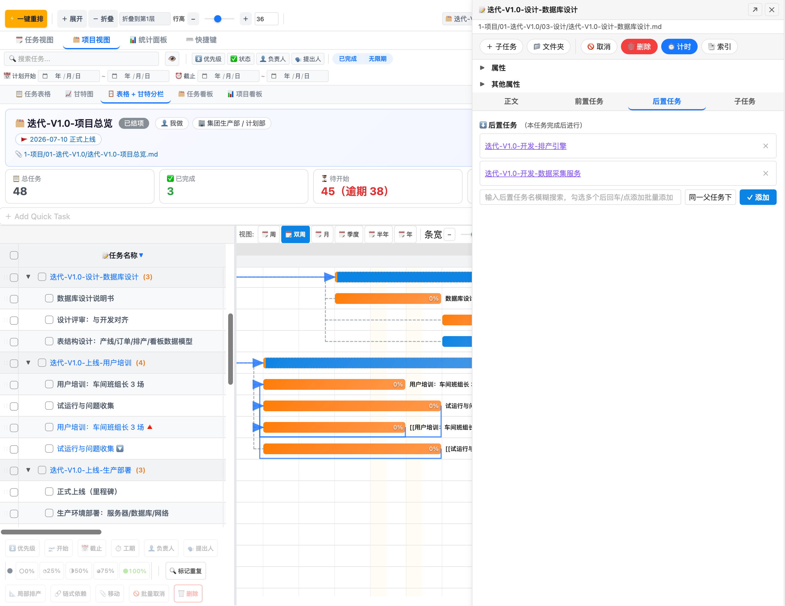
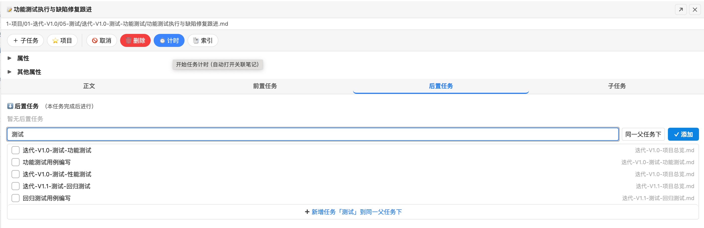
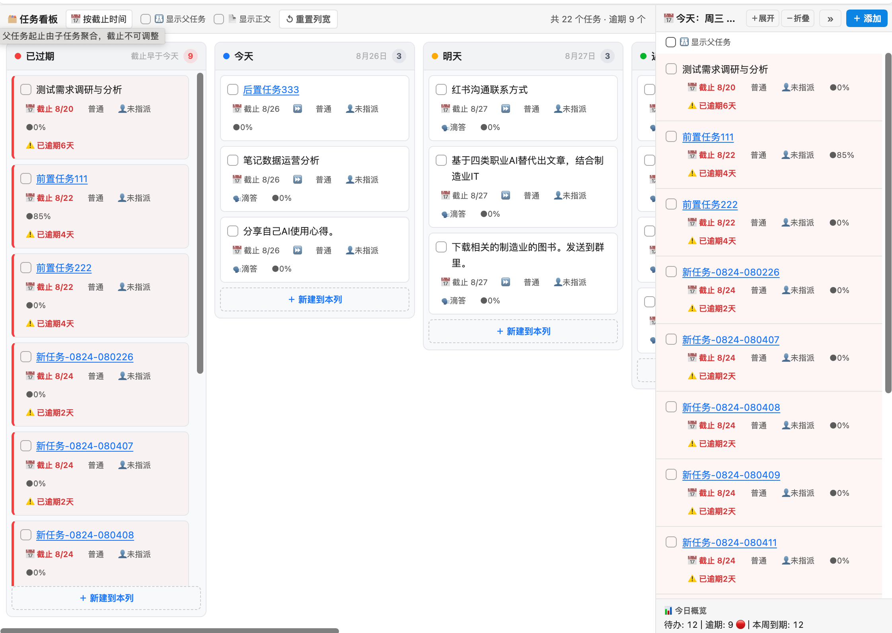

<div align="center">

# Task Nexus — Obsidian 任务排产插件（Pro）

**[中文](#-中文)** | **[English](#task-nexus--obsidian-gantt--task-scheduling-plugin-pro)**

> 🎯 只有一个 Pro 版：免费安装、免费额度内长期可用，激活码解除全部额度限制

</div>

> 📖 **[查看完整功能介绍 →](PRO.md)**

---

### 🚦 30 秒了解产品形态

| | 说明 |
|---|---|
| **① 免费安装** | Obsidian 社区插件市场（或从 GitHub Releases、下方一键下载）安装，无需付费 |
| **② 免费额度** | 项目 / 目标 / KR / 人员 / 自定义 Agent 有数量上限；AI 与同步类功能按月度额度试用；规划视图、链式依赖有试用次数 |
| **③ 激活解锁** | 购买激活码后在插件设置中填入，数量、月度与终身额度全部解除，功能不再受限 |

> ⚠️ **不再提供独立的基础版**：之前「免费版 + Pro 版」两个版本的叙述已废弃，安装包装的就是完整 Pro 版，只是未激活时按免费额度使用。

---

### 📥 一键下载（点击即存）

**[📥 唯一安装包 TaskNexusPro-1.0.70.zip（1.8 MB）](https://github.com/programerni/obsidian-TaskNexus-free/raw/main/downloads/TaskNexusPro-1.0.70.zip)**

> 🔑 激活方式：下载并启用插件后，在 设置 → TaskNexus → 「激活」输入个人邮箱提交申请，激活码会自动发到你的邮箱（详见 [PRO.md](PRO.md)）。

---

## 🇨🇳 中文

TaskNexus 将你的 Obsidian 知识库转变为可视化项目管理空间。在交互式甘特图上查看所有任务，一键重新排期，拖拽管理工作流。

### ✨ 功能特性

#### 📊 交互式甘特图
- **月/日双行时间轴**，5 种缩放级别（双周 → 年）
- **今日标记** — 蓝色竖线自动滚动
- **彩色任务条** 按状态区分（待办、已完成、进行中）
- **进度百分比** 显示在任务条内部（MS Project 风格）
- **父子依赖连线**（树形结构连接）



#### ✏️ 行内编辑
- **拖拽排期** — 左右移动任务条改变日期
- **拖拽调整** — 拖动右边缘调整工期
- **双击编辑** 名称、日期、优先级等
- **勾选完成** — 自动写入 ✅ 完成日期

#### 🔍 智能筛选
- **关键词搜索** 实时过滤
- **下拉筛选** — 优先级、状态、负责人、提出人
- **开关切换** — 显示/隐藏已完成任务、无限任务

#### 📁 任务层级
- **缩进子任务** 通过 Tab/4 空格缩进
- **跨文件 wiki-link 父任务** — `[[父任务名]]` 建立层级关系
- **折叠/展开** 工具栏一键操作



#### 🚀 一键排期
- **自动排期** — 移动逾期任务、分散过载、尊重依赖关系
- **局部排期** — 仅排期选中的任务



#### 📦 批量操作
- **多选** — 点击、Shift+点击范围、Ctrl+A 全选
- **批量设置** 优先级、日期、工期、进度
- **批量删除** 支持撤销

#### 💾 数据安全
- **一键备份/恢复** 到 `.task-gantt/data_backups/`
- **变更记录** 跨会话保留
- **撤销/重做** — Ctrl+Z / Ctrl+Shift+Z

#### ⌨️ 快捷键
- `Ctrl+Shift+T` — 快速添加任务
- 完整键盘导航支持

---

### 🆚 免费额度 vs 激活解锁

只有一个 Pro 版，同一条产品线的两种状态：未激活按免费额度使用，激活后全部解除。

| 能力 / 额度 | 免费额度（未激活） | 激活后 |
|------|:------:|:------:|
| 安装与更新 | 免费 | 免费（后续版本更新不收费） |
| 甘特图 / 看板 / 日历等全部视图 | ✅ | ✅ |
| 项目数 | ≤ 3 | 无限制 |
| 目标（OKR）数 | ≤ 3 | 无限制 |
| KR 数 | ≤ 9 | 无限制 |
| 人员数 | ≤ 3 | 无限制 |
| 自定义 Agent 数 | ≤ 2 | 无限制 |
| AI 任务拆解 | 5 次 / 月 | 无限制 |
| AI 作业续杯 | 5 次 / 月 | 无限制 |
| AI 作业累计 | 50 次 | 无限制 |
| AI 会议纪要 / 微信整理 | 3 次 / 月 | 无限制 |
| AI 复盘报表 | 4 次 / 月 | 无限制 |
| 滴答清单 / 飞书 / Notion 同步 | 各 50 条 / 月 | 无限制 |
| 规划视图 / 链式依赖 | 各 30 次试用 | 无限制 |
| 价格 | 免费安装、免费使用 | 按年 9.9 或一次 68 元（以小红书实际价格为准） |

> 额度为程序内置默认值，可能随版本调整；准确数值以插件内「激活 / 额度中心」与官网配置为准。额度用尽后仅对应功能暂停，历史数据不受影响。

---

### 🔑 获取激活码与激活

Pro 版全部功能随安装包提供，激活码只负责解除额度限制。购买方式：小红书主页 → 置顶笔记 → 个人售卖直接购买（按年 9.9 或一次性 68 元，具体以小红书实际价格为准）。

激活步骤：

1. 打开 Obsidian → 设置 → TaskNexus → 「激活」
2. 在「🔑 激活码」输入框填入激活码
3. 点「🔓 立即激活」，额度限制即时解除

- **🌐 官网与激活说明**: [https://tasknexus.itwize.top/](https://tasknexus.itwize.top/)
- **📕 小红书（购买渠道）**: [Task Nexus 小红书主页](https://www.xiaohongshu.com/user/profile/55878c26c2bdeb61d6dcbb31)
- **📖 完整功能介绍**: [PRO.md](PRO.md)

#### 💳 三种付款方式，任选其一

<table>
<tr>
<td align="center"><b>📕 小红书</b><br>主页 → 置顶笔记 → 个人售卖<br>按年 9.9 / 一次性 68 元<br><a href="https://www.xiaohongshu.com/user/profile/55878c26c2bdeb61d6dcbb31">前往下单</a></td>
<td align="center"><b>微信收款码</b><br><br>微信「扫一扫」</td>
<td align="center"><b>支付宝收款码</b><br><br>支付宝「扫一扫」</td>
</tr>
</table>

- 付款后把**付款截图**和你的邮箱 / 微信号发给我们：微信 **ITzhihui_hj**（备注「TaskNexus 激活」）或邮件 **it_wisdom@qq.com**
- 三个渠道**价格一致**，任选其一，核对后当天发放激活码，不必重复付款

---

### 📦 安装方式

#### 唯一安装方式：下载 zip 解压

1. 下载 [TaskNexusPro-1.0.70.zip](https://github.com/programerni/obsidian-TaskNexus-free/raw/main/downloads/TaskNexusPro-1.0.70.zip)（1.8 MB，仓库内唯一安装包）
2. 解压 zip 文件
3. 把三个文件放到 Obsidian 库的插件目录：
   ```
   你的库/.obsidian/plugins/tasknexus-pro/
   ├── main.js
   ├── manifest.json
   └── styles.css
   ```
4. 打开 Obsidian → 设置 → 第三方插件 → 点「刷新」
5. 启用 **TaskNexus Pro**（未激活时按免费额度使用，填入激活码后全部额度解除）

---

### 📋 系统要求

- Obsidian v1.5.7 或更高版本
- 桌面端或移动端（Pro 版均支持）

---

### 🛠️ 从源码构建

```bash
git clone https://github.com/programerni/obsidian-tasknexus-free.git
cd obsidian-tasknexus-free
npm install
node scripts/build-editions.mjs --edition free
```

构建产物位于 `dist/free/<版本号>/`。

---

### 📝 更新日志

详见 [CHANGELOG.md](CHANGELOG.md)。

---

### 📄 开源协议

MIT 协议 — 详见 [LICENSE](LICENSE)。

---

### 🤝 贡献

欢迎贡献代码！请提交 Pull Request。重大更改请先开 Issue 讨论。

---

### 📞 联系与支持

- **官网**: [https://tasknexus.itwize.top/](https://tasknexus.itwize.top/)
- **微信**: 激活问题请微信联系，扫描下方二维码

  

- **小红书**: [https://www.xiaohongshu.com/user/profile/55878c26c2bdeb61d6dcbb31](https://www.xiaohongshu.com/user/profile/55878c26c2bdeb61d6dcbb31)
- **GitHub Issues**: [提交 Bug 或功能建议](../../issues)

---

<p align="center">
  <b>Task Nexus Pro</b> — Obsidian 可视化任务排产插件<br>
  Made with ❤️ by <a href="https://github.com/programerni">Simon Ni</a>
</p>

---
---

<div align="center">

# Task Nexus — Obsidian Gantt & Task Scheduling Plugin (Pro)

**[中文](#-中文)** | **[English](#task-nexus--obsidian-gantt--task-scheduling-plugin-pro)**

> 🎯 One Pro edition: install free, use it within the free quota, and a licence key removes every quota limit

</div>

---

### 🚦 The product in 30 seconds

| | What it means |
|---|---|
| **① Install free** | Available in the Obsidian community plugin list (or from GitHub Releases and the direct download above) — no payment needed |
| **② Free quota** | Quantity caps for projects / goals / key results / people / custom agents; monthly quotas for AI and sync features; trial runs for the planning view and chained dependencies |
| **③ Licence unlocks** | Buy a licence key, paste it into the plugin settings, and every quantity, monthly and lifetime quota is removed |

> ⚠️ **There is no separate basic edition any more.** The old “Free + Pro” split is retired: the installer is the full Pro edition and simply runs within the free quota until activated.

---

Task Nexus transforms your Obsidian vault into a visual project management workspace. View all your tasks on an interactive Gantt chart, reschedule with one click, and manage your workflow with drag-and-drop ease.

### ✨ Features

#### 📊 Interactive Gantt Chart
- **Monthly/Daily dual-row timeline** with 5 zoom levels (biweekly → yearly)
- **Today marker** — blue vertical line with auto-scroll
- **Color-coded task bars** by status (todo, done, in-progress)
- **Progress percentage** displayed inside each bar (MS Project style)
- **Parent-child dependency lines** (tree-style connections)


#### ✏️ Inline Editing
- **Drag to reschedule** — move task bars left/right to change dates
- **Drag to resize** — pull the right edge to adjust duration
- **Double-click** to edit name, dates, priority, and more
- **Checkbox completion** — auto-writes ✅ completion date

#### 🔍 Smart Filtering
- **Keyword search** with real-time filtering
- **Dropdown filters** — priority, status, assignee, proposer
- **Toggle switches** — show/hide completed tasks, unlimited tasks

#### 📁 Task Hierarchy
- **Indented sub-tasks** via Tab/4-space indentation
- **Cross-file wiki-link parents** — `[[parent task]]` establishes hierarchy
- **Fold/expand** all levels from the toolbar


#### 🚀 One-Click Reschedule
- **Auto reschedule** — moves overdue tasks, distributes overloads, respects dependencies
- **Local reschedule** — only reschedule selected tasks


#### 📦 Batch Operations
- **Multi-select** — click, Shift+click range, Ctrl+A all
- **Batch set** priority, dates, duration, progress
- **Batch delete** with undo support

#### 💾 Data Safety
- **One-click backup/restore** to `.task-gantt/data_backups/`
- **Change log** preserved across sessions
- **Undo/Redo** — Ctrl+Z / Ctrl+Shift+Z

#### ⌨️ Keyboard Shortcuts
- `Ctrl+Shift+T` — Quick add task
- Full keyboard navigation support

---

### 🆚 Free quota vs licence

One Pro edition, two states of the same product line: the free quota applies before activation, and a licence removes every limit.

| Capability / quota | Free quota (no licence) | After activation |
|------|:------:|:------:|
| Install & updates | Free | Free (future updates included) |
| Gantt / kanban / calendar and every other view | ✅ | ✅ |
| Projects | ≤ 3 | Unlimited |
| Goals (OKR) | ≤ 3 | Unlimited |
| Key results | ≤ 9 | Unlimited |
| People | ≤ 3 | Unlimited |
| Custom agents | ≤ 2 | Unlimited |
| AI task decomposition | 5 / month | Unlimited |
| AI job refills | 5 / month | Unlimited |
| AI jobs, lifetime | 50 runs | Unlimited |
| AI meeting notes / chat digest | 3 / month | Unlimited |
| AI review report | 4 / month | Unlimited |
| TickTick / Feishu / Notion sync | 50 items each / month | Unlimited |
| Planning view / chained dependencies | 30 trial uses each | Unlimited |
| Price | Free to install and use | $19.9 USD one-time (see [pricing](https://tasknexus.itwize.top/en/pricing.html)) |

> These are the built-in defaults and may change between releases; the plugin's activation / quota centre and the website config are the source of truth. When a quota runs out only that feature pauses — your existing data is untouched.

---

### 🔑 Licence and activation

Every Pro module ships in the same installer; the licence key only removes quotas. Buy a licence via the [pricing page](https://tasknexus.itwize.top/en/pricing.html) ($19.9 USD one-time) and you receive the key by email.

1. Open Obsidian → Settings → Task Nexus → Activation
2. Paste the key into the licence field
3. Click “🔓 Activate now” — every quota is lifted immediately

- **🌐 Website**: [https://tasknexus.itwize.top/](https://tasknexus.itwize.top/)
- **📖 Full feature guide**: [PRO.md](PRO.md)

#### 💳 Three ways to pay — pick one

<table>
<tr>
<td align="center"><b>📕 Xiaohongshu</b><br>Profile → pinned note → in-app sale<br>$19.9 one-time<br><a href="https://www.xiaohongshu.com/user/profile/55878c26c2bdeb61d6dcbb31">Open</a></td>
<td align="center"><b>WeChat Pay QR</b><br><br>Scan with WeChat</td>
<td align="center"><b>Alipay QR</b><br><br>Scan with Alipay</td>
</tr>
</table>

- Send the **payment screenshot** with your email to **it_wisdom@qq.com** (or WeChat **ITzhihui_hj**) and we issue the licence key the same day

---

### 📦 Installation

#### Single install method: download the zip and unzip

1. Download [TaskNexusPro-1.0.70.zip](https://github.com/programerni/obsidian-TaskNexus-free/raw/main/downloads/TaskNexusPro-1.0.70.zip) (1.8 MB — the only package in this repo)
2. Unzip the file
3. Put the three files into your vault's plugin directory:
   ```
   YourVault/.obsidian/plugins/tasknexus-pro/
   ├── main.js
   ├── manifest.json
   └── styles.css
   ```
4. Obsidian → Settings → Community plugins → reload
5. Enable **TaskNexus Pro** (free quota until you paste a licence key)

---

### 📋 Requirements

- Obsidian v1.5.7 or higher
- Desktop or Mobile (the Pro edition supports both)

---

### 🛠️ Building from Source

```bash
git clone https://github.com/programerni/obsidian-tasknexus-free.git
cd obsidian-tasknexus-free
npm install
node scripts/build-editions.mjs --edition free
```

The built files will be in `dist/free/<version>/`.

---

### 📝 Changelog

See [CHANGELOG.md](CHANGELOG.md) for full release history.

---

### 📄 License

MIT License — see [LICENSE](LICENSE) for details.

---

### 🤝 Contributing

Contributions are welcome! Please feel free to submit a Pull Request. For major changes, please open an issue first to discuss what you would like to change.

---

### 📞 Contact & Support

- **Website**: [https://tasknexus.itwize.top/](https://tasknexus.itwize.top/)
- **WeChat**: Scan the QR code below for activation issues and support

  

- **Xiaohongshu (小红书)**: [https://www.xiaohongshu.com/user/profile/55878c26c2bdeb61d6dcbb31](https://www.xiaohongshu.com/user/profile/55878c26c2bdeb61d6dcbb31)
- **GitHub Issues**: [Report bugs or request features](../../issues)

---

<p align="center">
  <b>Task Nexus Pro</b> — Visual task scheduling for Obsidian<br>
  Made with ❤️ by <a href="https://github.com/programerni">Simon Ni</a>
</p>
